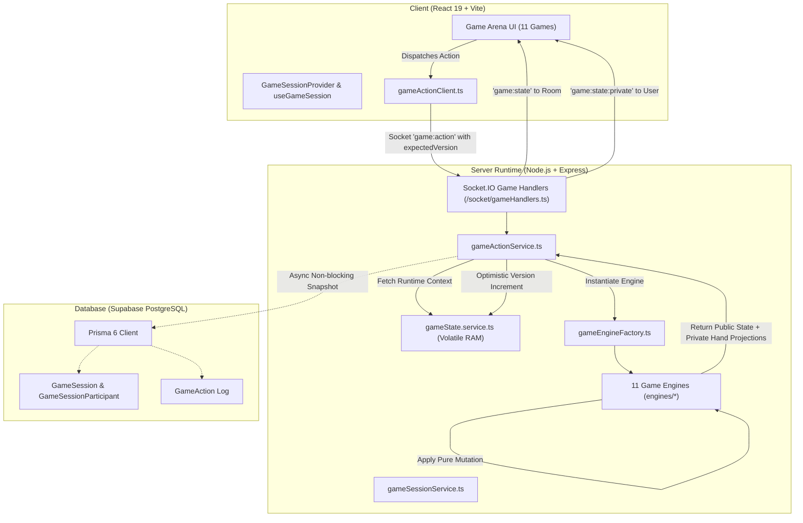

# PlaySpace Game Engine Architecture

This document describes the server-authoritative multiplayer game engine architecture implemented in Phase 3 for PlaySpace.

---

## 1. Architectural Overview

PlaySpace follows a **Server-Authoritative, Optimistic Real-Time Synchronized** architecture. The frontend React components render views based on state projections received from the server, capture player inputs (e.g., card taps, pen flicks, fry snatches), and dispatch actions to the backend. The backend validates each action against the current authoritative game state, executes state transitions, mutates scores, detects win conditions, and broadcasts state updates to all participants in the room via Socket.IO.



---

## 2. Core Abstractions & Interfaces

The core engine contract is defined in `server/src/modules/games/core/gameEngine.types.ts`:

### 2.1. `IGameEngine` Contract
Every one of the 11 games implements the strict `IGameEngine` interface:
```typescript
export interface IGameEngine<TState = any, TPrivateState = any, TAction = any> {
  readonly gameId: string;
  readonly name: string;
  readonly supportedModes: ('couple' | 'friend')[];
  readonly minPlayers: number;
  readonly maxPlayers: number;

  createInitialState(params: InitialStateParams): {
    state: TState;
    privateStates: Record<string, TPrivateState>;
    scores: Record<string, number>;
  };

  validateAction(
    action: TAction,
    context: GameEngineContext<TState, TPrivateState>,
    actorUserId: string
  ): { valid: boolean; error?: string };

  applyAction(
    action: TAction,
    context: GameEngineContext<TState, TPrivateState>,
    actorUserId: string
  ): ActionResult<TState, TPrivateState>;

  getPublicProjection(
    state: TState,
    context: GameEngineContext<TState, TPrivateState>
  ): Record<string, any>;

  getPrivateProjection(
    userId: string,
    state: TState,
    context: GameEngineContext<TState, TPrivateState>
  ): Record<string, any>;
}
```

---

## 3. Optimistic Concurrency & State Versioning

To prevent race conditions, double moves, and out-of-order execution, every game session maintains a monotonic `stateVersion: number`:

1. **Client Action Envelope**: When a player takes an action, the client dispatches:
   ```json
   {
     "sessionId": "gs-1740000000-abcde",
     "actionId": "act-1740000001-xyz",
     "expectedVersion": 4,
     "action": { "type": "PLAY_CARD", "cardId": "blue-7-2" }
   }
   ```
2. **Version Conflict Detection**: The server checks `context.version === expectedVersion`. If a concurrent action has already incremented the version, the action is rejected with `VERSION_CONFLICT`, prompting the client to re-synchronize before retrying.
3. **Idempotency**: An action with an already processed `actionId` returns the previous cached result immediately.

---

## 4. Privacy & State Isolation Model

Multiplayer games feature differing levels of information asymmetry:
- **Public State**: Broadly broadcast to all participants in `session:<sessionId>`.
- **Private State**: Individually projected and transmitted over a private socket channel exclusively to the authorized user.

### Information Isolation Rules:
1. **Original Card Game (UNO-Style)**:
   - *Public*: Active color, current discard top card, deck count, each player's hand count (`cardCounts[userId]`).
   - *Private*: The player's actual hand of cards (`privateStates[userId].hand`). Other players cannot inspect card IDs, colors, or values.
2. **Would You Rather & BETWEEN US**:
   - *Public*: Current question/prompt, submission status flags (`hasSubmitted: boolean`), reveal phase state.
   - *Private*: The user's pending choice or typed answer text during the answering phase.
3. **BETWEEN US Strict Privacy Engine**:
   - Zero persistence: Text answers are stored in volatile server memory only.
   - Transient lifecycle: Answer buffers are wiped immediately upon transition to the reveal phase.
   - Consent protection: Level 5 ("After Dark 18+") requires explicit dual mutual consent (`adultConsent: { [userId]: boolean }`) before question generation.

---

## 5. In-Memory Runtime Store & Graceful Database Synchronization

To deliver sub-50ms round-trip latency required by real-time games (e.g., Pen Fight, Basketball Rivalry, Snatch the Fries):
1. **Primary Runtime in Memory**: Active sessions reside in `GameStateService` (`server/src/modules/games/core/gameState.service.ts`) using high-speed in-memory maps.
2. **Non-Blocking Persistence**: When state transitions occur or match completes, state snapshots are asynchronously synchronized with PostgreSQL via Prisma 6 (`prisma.gameSession.update`).
3. **Graceful Degraded Mode**: If the database connection is offline or in development mock mode, the in-memory engine continues executing with 100% functionality without blocking user actions.

