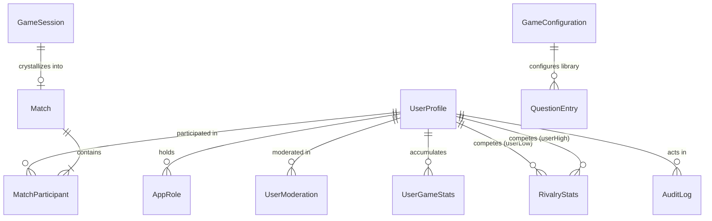

# PlaySpace — Phase 4 Data Models Reference
**Permanent Match History, Player Statistics, Rivalry System, Admin RBAC & Audit Architecture**

---

## 1. Overview & Architectural Principles

Phase 4 completes the permanent persistence layer for PlaySpace on Supabase PostgreSQL via Prisma ORM 6. It bridges runtime game sessions and ephemeral WebSocket actions with immutable match records, longitudinal statistical aggregates, head-to-head rivalry records, role-based access control, question libraries, and append-only audit trails.

### Core Principles
1. **Immutable Match Records**: Completed game sessions crystallize into immutable `Match` and `MatchParticipant` records. Subsequent updates to user profiles (username changes, avatar updates) never rewrite historical match snapshots.
2. **Canonical Rivalry Pairs**: Pairwise rivalry queries operate deterministically through lexicographical sorting (`userLowId < userHighId`), preventing duplicate mirrored rows and race conditions.
3. **Derived Aggregates with Reconcilability**: User statistics (`UserGameStats`) and rivalries (`RivalryStats`) are updated atomically in the same database transaction as the match finalization, and can be completely reconstructed or repaired from raw `MatchParticipant` records via the admin reconciliation engine.
4. **Strict Ephemeral Privacy**: Intimate and conversational gameplay data (specifically **BETWEEN US** personal answers and sensitive pending choices in **Would You Rather**) are strictly excluded from persistent tables. They exist exclusively in server volatile RAM during the live round and are discarded upon completion.
5. **Defense-in-Depth RBAC**: Global authorization rules are enforced at database constraints, Express route middlewares, socket handshakes, and UI navigation layers.

---

## 2. Entity-Relationship Diagram



---

## 3. Schema Specifications

### 3.1 `UserProfile` Extensions
The existing `UserProfile` table from Phase 1 is extended with account status lifecycle tracking:

```prisma
enum AccountStatus {
  ACTIVE
  SUSPENDED
  PENDING_VERIFICATION
}

// Added to UserProfile:
accountStatus AccountStatus @default(ACTIVE)
```

- **Default**: `ACTIVE`.
- **Enforcement**: When set to `SUSPENDED`, Socket.IO connection handshakes are rejected, active sockets are forcefully disconnected with `disconnect()`, and API requests are blocked with HTTP `403 Forbidden` (`ACCOUNT_SUSPENDED`).

---

### 3.2 `Match`
Represents an authoritative, finalized multiplayer game instance.

| Column | Type | Constraints | Description |
|---|---|---|---|
| `id` | String | PK (`uuid`/cuid) | Unique match identifier |
| `gameSessionId` | String | Unique | Source runtime session ID (ensures idempotent finalization) |
| `roomId` | String | Indexed | Room code/ID where match occurred |
| `gameId` | String | Indexed | Game catalog identifier (`uno-flip`, `basketball-rivalry`, etc.) |
| `mode` | String | | Room mode (`COUPLE`, `FRIEND`) |
| `resultType` | String | | `COMPETITIVE`, `COOPERATIVE`, `SURVIVAL`, `DRAW` |
| `winnerUserId` | String? | FK -> UserProfile | Winning participant's user ID (null for ties/cooperative) |
| `startedAt` | DateTime | | Timestamp when game match commenced |
| `completedAt` | DateTime | | Timestamp when game completed |
| `durationSeconds`| Int | | Duration of match in seconds |
| `roundsPlayed` | Int | Default 1 | Total rounds completed in session |
| `resultSummary` | Json | Default `{}` | Sanitized final outcome metadata (scores, rankings) |
| `createdAt` | DateTime | Default `now()` | Record insertion timestamp |

**Indexes**:
- `@@index([gameId])`
- `@@index([roomId])`
- `@@index([completedAt])`
- `@@index([winnerUserId])`

---

### 3.3 `MatchParticipant`
Represents a player's performance in a finalized match. Contains immutable snapshot fields of player display details at the exact moment of match completion.

| Column | Type | Constraints | Description |
|---|---|---|---|
| `id` | String | PK | Participant record ID |
| `matchId` | String | FK -> Match (Cascade) | Match reference |
| `userId` | String | FK -> UserProfile (Cascade) | Player user ID |
| `playerNameSnapshot` | String | | Display name snapshot at finalization |
| `usernameSnapshot` | String | | Unique username snapshot at finalization |
| `avatarUrlSnapshot`| String? | | Avatar URL snapshot |
| `scoreValue` | Float? | | Numeric score (points, strokes, alignment %) |
| `scoreLabel` | String? | | Displayable score formatted string (`3 baskets`, `5 strokes`) |
| `placement` | Int? | | Rank placement (1 = 1st, 2 = 2nd) |
| `outcome` | String | | `WIN`, `LOSS`, `TIE`, `COMPLETED` |
| `isWinner` | Boolean | Default false | Boolean winner flag |
| `statsDetail` | Json | Default `{}` | Game-specific stats (accuracy, cards drawn, fouls) |
| `createdAt` | DateTime | Default `now()` | Timestamp |

**Indexes**:
- `@@unique([matchId, userId])` (prevents duplicate participant entry)
- `@@index([userId])`
- `@@index([outcome])`

---

### 3.4 `UserGameStats`
Stores longitudinal performance metrics for a specific user in a specific game.

| Column | Type | Constraints | Description |
|---|---|---|---|
| `id` | String | PK | Aggregate stat record ID |
| `userId` | String | FK -> UserProfile (Cascade) | Target player |
| `gameId` | String | | Game identifier |
| `matchesPlayed` | Int | Default 0 | Total completed matches |
| `wins` | Int | Default 0 | Total wins |
| `losses` | Int | Default 0 | Total losses |
| `ties` | Int | Default 0 | Total draws/ties |
| `winRate` | Float | Default 0.0 | Calculated `(wins / (matchesPlayed - ties))` ratio |
| `currentStreak` | Int | Default 0 | Active streak count |
| `bestStreak` | Int | Default 0 | Highest historical winning streak |
| `streakType` | String | Default `NONE` | `WIN`, `LOSS`, `NONE` |
| `totalScore` | Float | Default 0.0 | Cumulative score for average calculations |
| `highestScore` | Float? | | High score record |
| `totalDurationSeconds` | Int | Default 0 | Total time spent playing this game |
| `lastPlayedAt` | DateTime | Default `now()` | Last played match timestamp |
| `updatedAt` | DateTime | Auto-update | Last update timestamp |

**Indexes**:
- `@@unique([userId, gameId])` (composite key for atomic upserts)
- `@@index([userId])`
- `@@index([gameId])`

---

### 3.5 `RivalryStats`
Maintains canonical head-to-head metrics between two users.

**Canonical Ordering Invariant**:
`userLowId = idA < idB ? idA : idB`
`userHighId = idA < idB ? idB : idA`

| Column | Type | Constraints | Description |
|---|---|---|---|
| `id` | String | PK | Rivalry record ID |
| `userLowId` | String | FK -> UserProfile (Cascade) | Lexicographically lower user ID |
| `userHighId` | String | FK -> UserProfile (Cascade) | Lexicographically higher user ID |
| `gameId` | String? | | Optional game filter (null = all games aggregate) |
| `matchesPlayed` | Int | Default 0 | Head-to-head matches |
| `userLowWins` | Int | Default 0 | Wins by `userLow` |
| `userHighWins` | Int | Default 0 | Wins by `userHigh` |
| `ties` | Int | Default 0 | Draws |
| `currentStreakLeaderId` | String? | | Active streak holder |
| `currentStreakCount` | Int | Default 0 | Active head-to-head streak length |
| `lastPlayedAt` | DateTime | Default `now()` | Last clash timestamp |
| `updatedAt` | DateTime | Auto-update | Update timestamp |

**Indexes**:
- `@@unique([userLowId, userHighId, gameId])` (enforces single canonical record per pair)
- `@@index([userLowId])`
- `@@index([userHighId])`

---

### 3.6 `AppRole` & `UserModeration`
Manages Role-Based Access Control and moderation history.

```prisma
enum RoleType {
  ADMIN
  MODERATOR
  USER
}

enum ModerationAction {
  SUSPEND
  UNSUSPEND
  WARN
  FLAG
}
```

- **`AppRole`**: `id`, `userId`, `role` (`RoleType`), `grantedById` (FK), `grantedAt`. Unique index on `@@unique([userId, role])`.
- **`UserModeration`**: `id`, `userId` (FK), `moderatorId` (FK), `action` (`ModerationAction`), `reason` (Text), `note` (Text?), `createdAt`.

---

### 3.7 `GameConfiguration` & `QuestionEntry`
Governs platform game availability and dynamic question catalogs.

- **`GameConfiguration`**:
  - `gameId`: Unique catalog string (`truth-or-dare`, `kabza`, etc.).
  - `isEnabled`: Global platform availability toggle.
  - `coupleModeEnabled`: Toggle for couple 2-player lobbies.
  - `friendModeEnabled`: Toggle for friend 4-player lobbies.
  - **Constraint Rule**: Games declared Couple-only (`truth-or-dare`, `would-you-rather`, `between-us`) cannot have `friendModeEnabled = true`.
  - `minPlayers`, `maxPlayers`, `maintenanceNotice`, `updatedById`.
- **`QuestionEntry`**:
  - `gameId`: Associated game (`truth-or-dare`, `would-you-rather`, `between-us`).
  - `category`: Question category string (`Couples`, `Spicy`, `Deep`, `Funny`).
  - `intensity`: Integer rating (1 = Soft, 2 = Spicy, 3 = Wild).
  - `prompt`: Main question text.
  - `optionA`, `optionB`: Binary choice options (mandatory for Would You Rather).
  - `isActive`: Boolean toggle.
  - `addedById`: Operator ID.

---

### 3.8 `AuditLog`
Append-only immutable record of all administrative and security actions.

| Column | Type | Constraints | Description |
|---|---|---|---|
| `id` | String | PK | Audit event ID |
| `actorId` | String | FK -> UserProfile | Administrator or moderator initiating action |
| `action` | String | Indexed | Action identifier (`ROLE_GRANTED`, `USER_SUSPENDED`, etc.) |
| `targetType` | String | | `USER`, `GAME`, `QUESTION`, `SYSTEM` |
| `targetId` | String? | | Targeted entity identifier |
| `details` | Json | Default `{}` | Sanitized metadata of change |
| `ipAddress` | String? | | Client IP address |
| `createdAt` | DateTime | Default `now()` | Insertion timestamp |

---

## 4. Migration Plan & Safety

The migration script is stored at:
`server/prisma/migrations/20261030030000_phase4_match_history_stats_admin/migration.sql`

- **Preservation**: All Phase 1, 2, and 3 tables (`UserProfile`, `UserSettings`, `Friendship`, `FriendRequest`, `Block`, `Room`, `RoomParticipant`, `GameSession`, `GameAction`) remain intact.
- **Backwards Compatibility**: New columns on existing tables have safe defaults (`accountStatus` defaults to `'ACTIVE'`).
- **No Destruction**: No destructive `DROP TABLE`, `DROP COLUMN`, or `TRUNCATE` statements exist in the migration.

