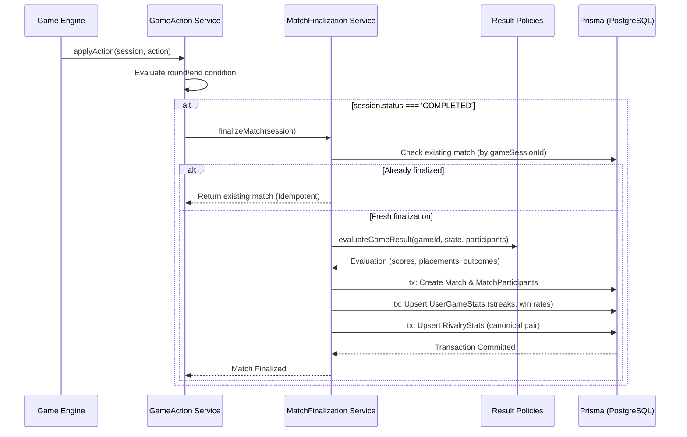

# PlaySpace — Phase 4 Match History API Reference
**Permanent Match Records, Detailed Performance Breakdowns & Finalization Pipeline**

---

## 1. Overview

The Match History subsystem provides authenticated users with access to their permanent, authoritative multiplayer match logs. Matches are recorded authoritatively by the backend game engine upon game completion, guaranteeing tamper-proof records across competitive, cooperative, and alignment games.

---

## 2. API Endpoints

### 2.1 Retrieve User Match History
Fetches a paginated list of matches involving the authenticated user, with optional filtering by game, mode, outcome, and specific rival.

- **Method**: `GET`
- **Path**: `/api/v1/matches/history`
- **Authentication**: Required (`Bearer <supabase_access_token>`)
- **Rate Limit**: Standard authenticated limits (100 req / min)

#### Query Parameters
| Parameter | Type | Required | Description | Example |
|---|---|---|---|---|
| `gameId` | String | No | Filter by specific game catalog ID | `basketball-rivalry` |
| `mode` | String | No | Filter by room mode (`COUPLE`, `FRIEND`) | `COUPLE` |
| `outcome` | String | No | Filter by personal outcome (`WIN`, `LOSS`, `TIE`, `COMPLETED`) | `WIN` |
| `rivalUserId`| String | No | Filter for matches played against a specific player | `uuid-rival-123` |
| `page` | Integer | No | Page number (default: 1) | `1` |
| `limit` | Integer | No | Page size (default: 15, max: 50) | `15` |

#### Successful Response (`200 OK`)
```json
{
  "success": true,
  "data": [
    {
      "id": "match-1730300000-abc12",
      "gameSessionId": "sess-8f12-xyz",
      "roomId": "LOVE22",
      "gameId": "basketball-rivalry",
      "mode": "COUPLE",
      "resultType": "COMPETITIVE",
      "winnerUserId": "user-uuid-1",
      "startedAt": "2026-10-30T10:15:00.000Z",
      "completedAt": "2026-10-30T10:20:00.000Z",
      "durationSeconds": 300,
      "roundsPlayed": 3,
      "resultSummary": {
        "scores": {
          "user-uuid-1": 15,
          "user-uuid-2": 12
        }
      },
      "myPerformance": {
        "scoreValue": 15,
        "scoreLabel": "15 pts",
        "placement": 1,
        "outcome": "WIN",
        "isWinner": true
      },
      "participants": [
        {
          "id": "mp-1",
          "userId": "user-uuid-1",
          "playerNameSnapshot": "Alex",
          "usernameSnapshot": "alex_player",
          "avatarUrlSnapshot": "https://api.dicebear.com/7.x/bottts/svg?seed=Alex",
          "scoreValue": 15,
          "scoreLabel": "15 pts",
          "placement": 1,
          "outcome": "WIN",
          "isWinner": true
        },
        {
          "id": "mp-2",
          "userId": "user-uuid-2",
          "playerNameSnapshot": "Taylor",
          "usernameSnapshot": "taylor_player",
          "avatarUrlSnapshot": null,
          "scoreValue": 12,
          "scoreLabel": "12 pts",
          "placement": 2,
          "outcome": "LOSS",
          "isWinner": false
        }
      ]
    }
  ],
  "pagination": {
    "page": 1,
    "limit": 15,
    "total": 42,
    "totalPages": 3
  }
}
```

---

### 2.2 Retrieve Match Details
Fetches full details and participant metrics for a single completed match.

- **Method**: `GET`
- **Path**: `/api/v1/matches/:matchId`
- **Authentication**: Required (`Bearer <supabase_access_token>`)

#### Path Parameters
- `matchId` (string, required): The ID of the match to retrieve.

#### Successful Response (`200 OK`)
```json
{
  "success": true,
  "data": {
    "id": "match-1730300000-abc12",
    "gameSessionId": "sess-8f12-xyz",
    "roomId": "LOVE22",
    "gameId": "basketball-rivalry",
    "mode": "COUPLE",
    "resultType": "COMPETITIVE",
    "winnerUserId": "user-uuid-1",
    "startedAt": "2026-10-30T10:15:00.000Z",
    "completedAt": "2026-10-30T10:20:00.000Z",
    "durationSeconds": 300,
    "roundsPlayed": 3,
    "resultSummary": {
      "scores": {
        "user-uuid-1": 15,
        "user-uuid-2": 12
      }
    },
    "participants": [
      {
        "id": "mp-1",
        "userId": "user-uuid-1",
        "playerNameSnapshot": "Alex",
        "usernameSnapshot": "alex_player",
        "avatarUrlSnapshot": "https://api.dicebear.com/7.x/bottts/svg?seed=Alex",
        "scoreValue": 15,
        "scoreLabel": "15 pts",
        "placement": 1,
        "outcome": "WIN",
        "isWinner": true,
        "statsDetail": {
          "swishes": 4,
          "banks": 1,
          "misses": 2
        }
      },
      {
        "id": "mp-2",
        "userId": "user-uuid-2",
        "playerNameSnapshot": "Taylor",
        "usernameSnapshot": "taylor_player",
        "avatarUrlSnapshot": null,
        "scoreValue": 12,
        "scoreLabel": "12 pts",
        "placement": 2,
        "outcome": "LOSS",
        "isWinner": false,
        "statsDetail": {
          "swishes": 2,
          "banks": 3,
          "misses": 4
        }
      }
    ]
  }
}
```

#### Error Responses
- `401 Unauthorized`: Token missing or invalid.
- `404 Not Found`: Match ID does not exist or user is blocked from viewing.
- `500 Internal Server Error`: Server failure.

---

## 3. Server-Authoritative Finalization Pipeline

The lifecycle of a match from runtime state to permanent history executes strictly through `matchFinalization.service.ts`:



---

## 4. Privacy & Ephemeral Data Guarantees

In strict accordance with PlaySpace platform security:
1. **BETWEEN US**: All personal answers written by partners are held only in server RAM during the round. Neither `Match`, `MatchParticipant`, nor `AuditLog` ever stores answer text. Only question categories and round counts are logged.
2. **Would You Rather**: Individual pending dilemma selections are revealed to room participants upon sync and immediately scrubbed from persistent serialization.

